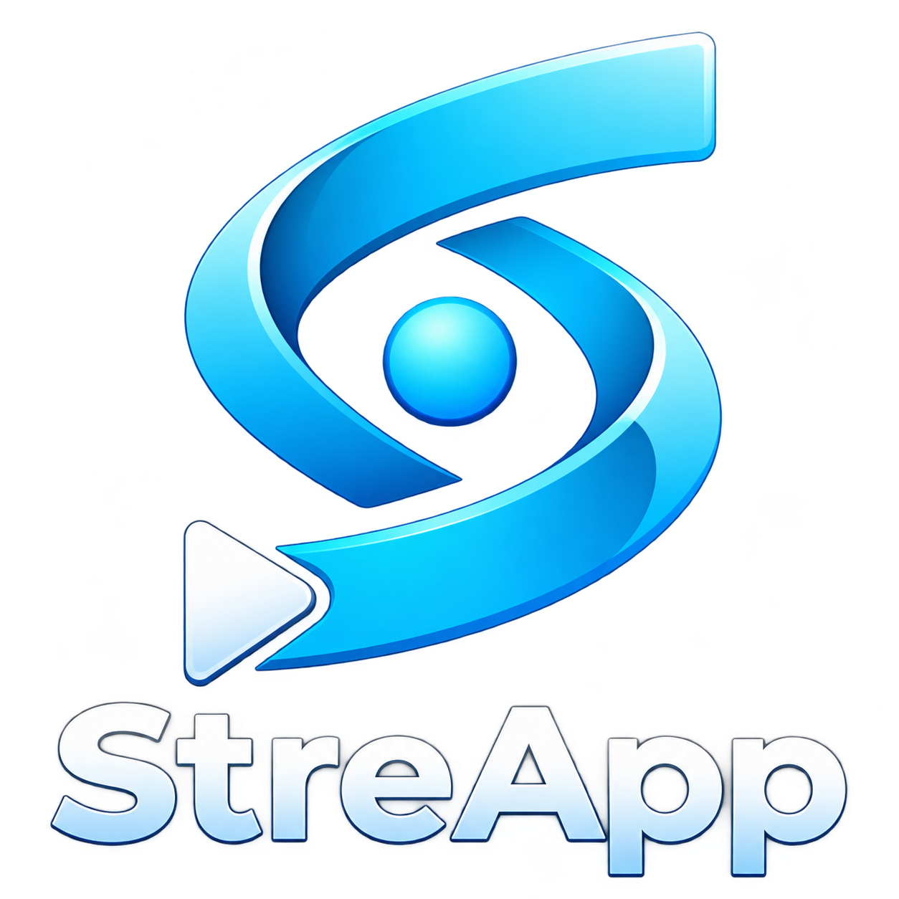

<p align="center">
  
</p>

<h1 align="center">StreApp</h1>

<p align="center">
  <strong>Aplikasi Android open-source yang terinspirasi dari OBS untuk merekam dan menyiarkan gabungan beberapa sumber video dan audio secara bersamaan.</strong>
</p>

<p align="center">
  <a href="#unduh-aplikasi-apk">Unduh APK</a> •
  <a href="#fitur-utama">Fitur Utama</a> •
  <a href="#persyaratan-perangkat">Persyaratan</a> •
  <a href="#arsitektur-modul">Arsitektur</a> •
  <a href="#cara-build-dari-source">Build dari Source</a> •
  <a href="#alur-pengembangan-dan-bantuan-ai">Pengembangan AI</a> •
  <a href="#lisensi">Lisensi</a>
</p>

---

## Ringkasan

**StreApp** adalah aplikasi studio rekam dan siaran untuk ponsel Android yang terinspirasi dari OBS Studio tanpa memerlukan laptop: menggabungkan feed capture card USB (UVC), rekam layar ponsel, kamera lokal, kamera dari ponsel kedua (*Camera Node*), overlay teks/gambar/video, serta mixer multi-sumber audio ke dalam satu scene, lalu merekamnya ke MP4 (tersegmentasi aman dari crash dan otomatis digabung utuh saat berhenti) dan/atau menyiarkannya langsung lewat RTMP/RTMPS dari satu pipeline encode hardware.

Proyek ini sepenuhnya gratis dan sumber terbuka: **tanpa watermark, tanpa iklan, tanpa akun paksaan, tanpa analitik pihak ketiga, dan tanpa SDK berbayar.**

---

## Unduh Aplikasi (APK)

Pengguna Android dapat langsung mengunduh dan memasang file `.apk` tanpa perlu mengompilasi kode sumber:

> **Unduh Langsung:** Buka halaman **[GitHub Releases](https://github.com/AlvinShofa13/StreApp.git/releases/latest)** lalu unduh berkas **`StreApp-android.apk`**.

### Cara Pemasangan di Android
1. Unduh **`StreApp-android.apk`** dari halaman **Releases** di sisi kanan repositori GitHub ini.
2. Buka berkas `.apk` yang sudah diunduh pada ponsel Android Anda.
3. Bila diminta oleh sistem, izinkan opsi **Pasang aplikasi tidak dikenal** (*Install unknown apps*) untuk browser atau manajer berkas Anda.
4. Selesaikan pemasangan dan buka **StreApp**.

### Otomatisasi Rilis APK di GitHub
Repositori ini sudah dilengkapi workflow GitHub Actions ([`.github/workflows/build-apk.yml`](.github/workflows/build-apk.yml)). Setiap kali Anda membuat tag versi baru (misalnya `git tag v1.0.0 && git push origin v1.0.0`), GitHub akan otomatis menjalankan unit test, membangun APK, dan melampirkannya pada halaman **Releases** agar pengunjung dapat langsung mengunduhnya.

---

## Fitur Utama

### Video & Kanvas Scene Interaktif
- **Multi-Sumber Bersamaan:** Gabungkan Capture Card USB (UVC), Rekam Layar ponsel (`MediaProjection`), Kamera Depan/Belakang (`Camera2`), Camera Node (ponsel kedua lewat Wi-Fi, Hotspot, atau Kabel USB Tethering), serta Overlay Teks, Gambar, dan Video Loop dalam satu scene.
- **Kanvas Scene Interaktif:** Ketuk sumber langsung pada pratinjau untuk memindah posisi (dengan *snap* otomatis ke tepi dan tengah), menarik sudut untuk mengatur besar-kecil ukuran, memilih orientasi kamera (**Potret 9:16** / **Lanskap 16:9**), mengatur urutan layer, serta memilih bentuk overlay (**Persegi**, **Sudut Membulat**, **Bulat**).
- **Scene & Template Cepat:** Buat, ganti nama, gandakan, dan pindah antar scene dengan satu ketukan menggunakan transisi **Potong Langsung (Cut)** atau **Pudar 0,3 detik (Fade)**.
- **Preset & Orientasi Output:** Mendukung 480p, 720p, dan 1080p pada 30 fps maupun 60 fps, dengan pilihan orientasi **Lanskap (16:9)** atau **Potret (9:16)**.
- **Zero-Copy GPU Pipeline:** Seluruh komposisi berjalan di OpenGL ES 3.0 (`SurfaceTexture` -> OpenGL -> `MediaCodec` H.264) tanpa penyalinan frame ke CPU, dengan satu pipeline encode bersama untuk rekaman dan siaran.

### Audio Mixer & Monitoring
- **Multi-Input Audio:** Mikrofon ponsel, headset kabel/Bluetooth, audio USB capture card, audio internal Android 10+ (bila diizinkan aplikasi), dan audio dari Camera Node.
- **Kontrol Lengkap:** Fader gain per saluran, tombol bisukan (*mute*), level meter real-time, serta tiga mode monitoring (**Mati**, **Hanya Monitor**, **Monitor & Rekam**) lengkap dengan peringatan umpan balik (*feedback*) bila tidak memakai headphone.

### Ketahanan, Siaran, & Chat Privat
- **Pemulihan Rekaman (Crash-Safe):** Perekaman MP4 ditulis berkala (tersegmentasi) dan dijalankan dalam *Foreground Service* agar rekaman tetap aman meski layar mati atau aplikasi berhenti mendadak.
- **Manajemen Termal & Estimasi Beban:** Memantau status termal Android secara otomatis dan menampilkan estimasi beban sebelum merekam.
- **Mode Dua Ponsel (Camera Node):** Pairing cepat lewat kode QR terenkripsi pada Wi-Fi atau hotspot yang sama.
- **Live Streaming RTMP/RTMPS:** Mendukung profil akun YouTube, Twitch, dan TikTok dengan penyimpanan *stream key* terenkripsi menggunakan **Android Keystore**.
- **Panel Chat Privat (Baca-Saja):** Hanya tampil di layar pengguna (terpisah total dari kompositor video, tidak terekam, tidak tersiar), dibatasi 200 pesan terbaru di memori, dan mendukung penyaringan bot/perintah.

---

## Persyaratan Perangkat

| Komponen | Minimum / Acuan |
| --- | --- |
| Sistem Operasi | Android 10 (API 29) atau lebih baru (uji utama Android 12) |
| Arsitektur / Chipset | Diuji dengan batas bawah MediaTek Helio G99 dan Exynos 9825 |
| RAM | 4 GB (target anggaran memori di bawah 1,2 GB) |
| USB Capture Card | Ponsel dengan dukungan USB OTG / USB-C Host |

---

## Arsitektur Modul

Proyek ini dibangun menggunakan **Kotlin**, **Jetpack Compose (Material 3)**, dan **Gradle Kotlin DSL** dengan struktur modular tanpa dependensi melingkar:

```text
app/            UI Compose (tema terang), navigasi workspace OBS, service, engine
core-model/     Model murni Scene, Source, Preset, Project, dan serialisasi JSON
core-video/     Kompositor OpenGL ES 3.0, encoder H.264, segmented MP4 muxer
core-audio/     Mixer PCM khusus thread prioritas tinggi, meter, monitoring
core-thermal/   Pemantau suhu Android dan kebijakan penurunan kualitas adaptif
source-uvc/     Capture card dan webcam USB berbasis UVC (libuvc)
source-camera/  Kamera lokal ponsel (Camera2) dengan kontrol fokus/zoom/eksposur
source-screen/  Rekam layar ponsel melalui MediaProjection
source-remote/  Camera Node antar ponsel di jaringan lokal + QR pairing
stream/         Publisher RTMP/RTMPS dan penyimpanan stream key terenkripsi
chat/           Pembaca chat langsung baca-saja (terpisah dari pipeline video)
debug-overlay/  Overlay diagnostik fps, drop frame, CPU, suhu, dan memori
```

Dokumentasi spesifikasi dan daftar tugas pengembangan tersedia di [`docs/PRD.md`](docs/PRD.md) dan [`docs/TASKS.md`](docs/TASKS.md).

---

## Cara Build dari Source

### Prasyarat
- **JDK 17** (atau Android Studio terbaru dengan JetBrains Runtime terpasang)
- **Android SDK** (compileSdk 37 / minSdk 29)

### Perintah Build
```bash
# 1. Jalankan seluruh unit test
./gradlew test

# 2. Bangun APK debug
./gradlew assembleDebug

# 3. Pasang langsung ke perangkat Android via USB (adb)
./gradlew installDebug
```

Berkas APK hasil kompilasi akan tersedia di:
```text
app/build/outputs/apk/debug/app-debug.apk
```

---

## Privasi & Keamanan

- Seluruh pemrosesan video dan audio dilakukan secara lokal di perangkat; tidak ada pengunggahan otomatis maupun analitik pihak ketiga.
- *Stream key* dan kredensial API (bila digunakan pada modul chat YouTube) disimpan terenkripsi menggunakan **Android Keystore** dan tidak pernah ditulis ke dalam repositori.
- Koneksi Camera Node antar ponsel dienkripsi menggunakan token sesi sekali pakai dari kode QR.

---

## Alur Pengembangan dan Bantuan AI

Proyek ini dikembangkan secara bertahap dengan bantuan beberapa alat dan model AI pada tiap fase:

| Tahap | Peran / Cakupan | Alat & Model AI |
| --- | --- | --- |
| 1. Perancangan | Penyusunan spesifikasi dan dokumen (`PRD.md`, `design.md`, `AGENTS.md`) | Claude Sonnet 5.5 Medium |
| 2. Eksekusi Awal | Pembuatan fondasi proyek dan implementasi tahap awal | OpenCode — DeepSeek V4.1 Flash Free Default / OpenCode · max |
| 3. Eksekusi Pertengahan | Pengembangan lanjutan dan integrasi fitur tahap pertengahan | Gemini Flash 3.6 Agents (Android Studio) |
| 4. Eksekusi Akhir | Penyempurnaan pipeline, perbaikan performa, tampilan OBS Mobile, dan finalisasi | Antigravity App — Gemini 4 Neon High |

---

## Lisensi

Proyek ini dirilis di bawah lisensi **Apache License 2.0** (lihat [`LICENSE`](LICENSE)) dan hanya memanfaatkan komponen gratis serta berlisensi permisif (Apache-2.0, BSD, LGPL-2.1). Rincian lengkap seluruh pustaka pihak ketiga dan lisensinya tercatat di [`docs/LISENSI.md`](docs/LISENSI.md).
